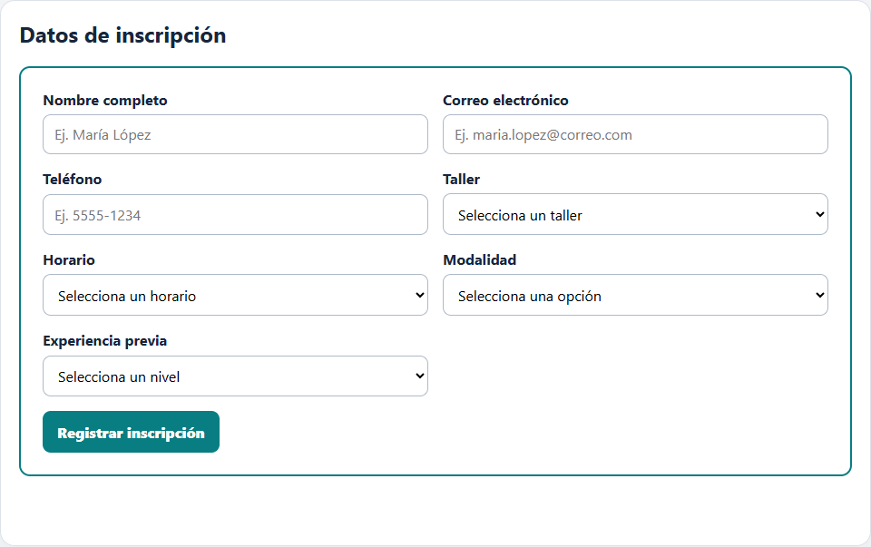
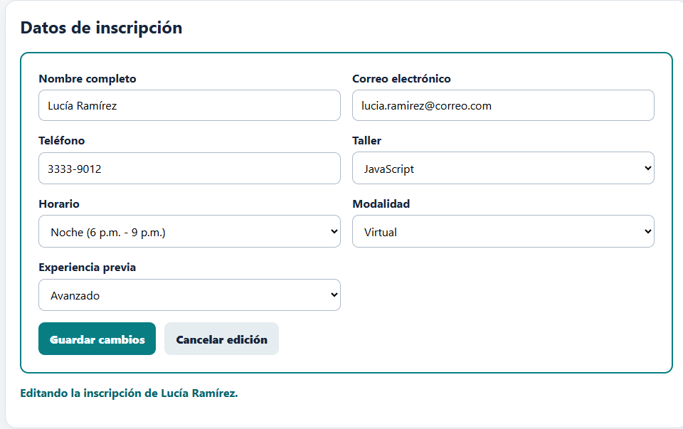
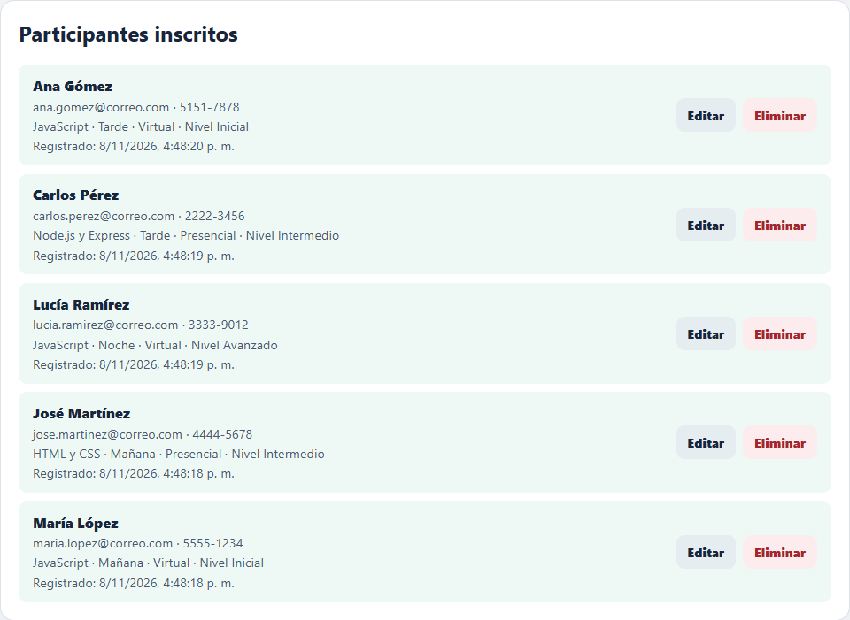
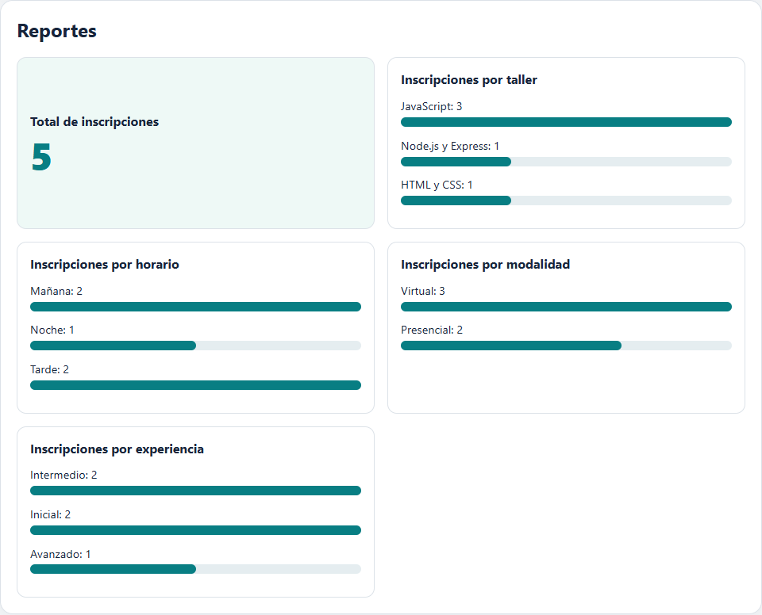
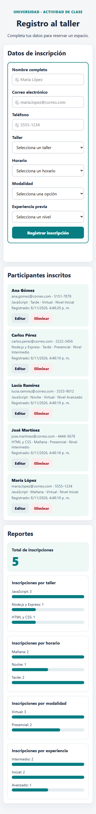

# Registro de participantes para el taller de Desarrollo Web

## Objetivo
Aplicación web para que una universidad registre a los participantes de su taller de Desarrollo Web. Desde una sola página se pueden **crear, consultar, editar y eliminar inscripciones**, que se guardan de forma permanente en una base de datos **SQLite**. La página también muestra un apartado de **reportes visuales** calculados directamente desde la base.

## Funcionalidades
- Formulario con siete campos obligatorios: nombre completo, correo, teléfono, taller, horario y los dos campos nuevos **modalidad** y **experiencia previa**.
- Validación en el navegador (`required`, `type="email"`, límites de longitud y `pattern` para el teléfono) y repetida en Express.
- Guardado persistente en SQLite: los datos siguen disponibles al recargar la página y al reiniciar el servidor.
- Lista de participantes con botones **Editar** y **Eliminar** en cada registro.
- El mismo formulario sirve para crear (POST) y para editar (PUT).
- Reportes con el total de inscripciones y barras por taller, horario, modalidad y experiencia.
- Diseño adaptable: dos columnas en pantallas amplias y una columna en teléfonos.

## Tecnologías
- HTML, CSS (Grid, Flexbox y media queries) y JavaScript (DOM, eventos y `fetch`).
- Node.js con Express.
- SQLite mediante el módulo integrado `node:sqlite`, así que no hace falta instalar un servidor de base de datos.

## Requisitos
- **Node.js 22.13 o posterior** (se recomienda una versión LTS reciente). Comprueba la versión con `node -v`.
- Visual Studio Code u otro editor.
- Conexión a internet la primera vez para instalar Express.

## Instalación y ejecución
1. Clona el repositorio y abre la carpeta en VS Code con **File → Open Folder**.
2. Abre una terminal con **Terminal → New Terminal**.
3. Instala las dependencias:

```bash
npm install
```

4. Inicia el servidor:

```bash
npm start
```

5. Abre `http://localhost:3000` en el navegador.
6. Para detener el servidor, presiona `Ctrl + C` en la terminal.

### Si PowerShell bloquea npm.ps1
Si aparece un mensaje que dice que la ejecución de scripts está deshabilitada, usa `npm.cmd install` y `npm.cmd start`, o cambia la terminal de VS Code a **Command Prompt** o **Git Bash**.

## Base de datos
- La conexión está en `database.js`. Usa `DatabaseSync` de `node:sqlite` para abrir el archivo `registro_taller.db`.
- No hay que configurar nada: al ejecutar `npm start`, el archivo **se crea automáticamente** junto a `server.js` si todavía no existe, y también se crea la tabla con `CREATE TABLE IF NOT EXISTS`.
- `registro_taller.db` está en `.gitignore`, así que la base local no se sube a GitHub.
- Para empezar con una base vacía, detén el servidor y borra `registro_taller.db`. Se vuelve a crear vacía en el siguiente `npm start`.

### Tabla `inscripciones`
| Columna | Tipo | Uso |
|---|---|---|
| `id` | INTEGER PRIMARY KEY AUTOINCREMENT | Identificador único; clave primaria |
| `nombre`, `correo`, `telefono` | TEXT NOT NULL | Datos del participante |
| `taller`, `horario` | TEXT NOT NULL | Selecciones del formulario |
| `modalidad` | TEXT NOT NULL | Campo nuevo: Presencial o Virtual |
| `nivel_experiencia` | TEXT NOT NULL | Campo nuevo: Inicial, Intermedio o Avanzado |
| `fecha_registro` | TEXT DEFAULT CURRENT_TIMESTAMP | Fecha y hora en que se guardó el registro (UTC) |

## Rutas de la API

| Método y ruta | Operación | Respuestas |
|---|---|---|
| `GET /api/inscripciones` | Devuelve todas las inscripciones guardadas, de la más reciente a la más antigua | `200` |
| `POST /api/inscripciones` | Valida y guarda una inscripción nueva | `201` creada · `400` datos inválidos |
| `PUT /api/inscripciones/:id` | Valida y actualiza la inscripción indicada | `200` actualizada · `400` datos o id inválidos · `404` no existe |
| `DELETE /api/inscripciones/:id` | Elimina la inscripción indicada | `200` eliminada · `400` id inválido · `404` no existe |
| `GET /api/reportes/resumen` | Devuelve los conteos para los reportes | `200` |

**Cuerpo que esperan POST y PUT:**

```json
{
  "nombre": "María López",
  "correo": "maria.lopez@correo.com",
  "telefono": "5555-1234",
  "taller": "JavaScript",
  "horario": "Tarde",
  "modalidad": "Virtual",
  "nivel_experiencia": "Inicial"
}
```

**Validaciones del servidor:**
- Todos los campos son obligatorios y se les quitan los espacios sobrantes.
- El nombre debe tener entre 2 y 80 caracteres.
- El correo debe tener el formato `texto@texto.texto`.
- El teléfono debe tener entre 8 y 15 caracteres: números, espacios, `+` o `-`.
- `taller`, `horario`, `modalidad` y `nivel_experiencia` deben ser una de las opciones del formulario.
- Las consultas usan sentencias preparadas con `?`, por lo que el texto recibido nunca se pega dentro del SQL.

**Ejemplo de respuesta de `GET /api/reportes/resumen`:**

```json
{
  "total": 5,
  "porTaller": [{ "taller": "JavaScript", "cantidad": 3 }],
  "porHorario": [{ "horario": "Tarde", "cantidad": 2 }],
  "porModalidad": [{ "modalidad": "Virtual", "cantidad": 3 }],
  "porNivel": [{ "nivel_experiencia": "Inicial", "cantidad": 2 }]
}
```

## Cómo probar cada operación

### Desde la página
Con el servidor encendido, abre `http://localhost:3000`:

| Operación | Cómo probarla |
|---|---|
| **Crear** | Llena el formulario y presiona **Registrar inscripción**. El registro aparece en la lista y los reportes se actualizan |
| **Leer** | Recarga la página: la lista muestra lo guardado en la base. También puedes abrir `http://localhost:3000/api/inscripciones` |
| **Actualizar** | Presiona **Editar** en un registro. Sus datos se cargan en el formulario; cambia algo y presiona **Guardar cambios** |
| **Eliminar** | Presiona **Eliminar** en un registro y confirma. Desaparece de la lista y de los reportes |
| **Reportes** | Abre `http://localhost:3000/api/reportes/resumen` y compara los números con la sección **Reportes** de la página |

### Desde la terminal (PowerShell)
Abre una segunda terminal mientras el servidor está encendido:

```powershell
$url = "http://localhost:3000/api/inscripciones"
$json = "application/json; charset=utf-8"
$datos = '{"nombre":"Ana Perez","correo":"ana.perez@correo.com","telefono":"5555-1234","taller":"JavaScript","horario":"Tarde","modalidad":"Virtual","nivel_experiencia":"Inicial"}'

# Crear (POST)
Invoke-RestMethod -Method Post -Uri $url -ContentType $json -Body $datos

# Leer (GET)
Invoke-RestMethod -Uri $url

# Actualizar (PUT): cambia el 1 por el id que quieras editar
Invoke-RestMethod -Method Put -Uri "$url/1" -ContentType $json -Body $datos.Replace("Tarde", "Noche")

# Eliminar (DELETE)
Invoke-RestMethod -Method Delete -Uri "$url/1"

# Reportes
Invoke-RestMethod -Uri http://localhost:3000/api/reportes/resumen
```

Para ver un error `400`, envía el POST con un correo sin `@`. Para ver un `404`, usa PUT o DELETE con un id que no exista.

### Lista de pruebas
| Prueba | Resultado esperado |
|---|---|
| Crear | POST guarda una fila; aparece en la lista y en los reportes |
| Leer | GET muestra las inscripciones guardadas en la base |
| Actualizar | PUT modifica la fila correcta y la lista muestra el cambio |
| Eliminar | DELETE elimina la fila y actualiza la lista y los reportes |
| Validación | Un correo inválido o un campo obligatorio vacío no se guarda |
| Persistencia | Al recargar la página y reiniciar el servidor, los datos continúan |
| Diseño | El formulario y los reportes se ven bien en móvil y escritorio |
| Reporte | El total y las agrupaciones coinciden con la base |

## Capturas
Todas las capturas usan datos inventados.

**Formulario** (dos columnas en escritorio):



**Editando una inscripción:**



**Lista con acciones de editar y eliminar:**



**Reporte visual:**



**Vista en teléfono** (375 px):



## Estructura del proyecto
```
registro-taller-estudiante/
├── server.js            # Servidor Express y rutas de la API
├── database.js          # Conexión a SQLite y creación de la tabla
├── package.json         # Dependencias y script npm start
├── public/
│   ├── index.html       # Formulario, lista y reportes
│   ├── styles.css       # Estilos, Grid y media queries
│   └── app.js           # fetch para crear, editar, eliminar y reportes
├── docs/capturas/       # Evidencias de funcionamiento
├── README.md
└── bitacora.md          # Bitácora de repaso
```
